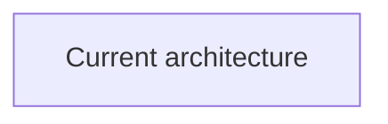
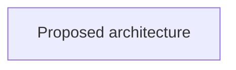

---
status:
date:
decision-makers:
consulted:
informed:
---

# <!-- short title, representative of solved problem and found solution -->

## 1. Context and Problem Statement

## 2. Decision Drivers

* <!-- decision driver -->

## 3. Considered Options

* <!-- option -->

## 4. Decision Outcome

Chosen option: "", because

### 4.1 Before and After

<!--
Choose one Mermaid diagram family and use it for both views:
- sequenceDiagram for interactions, ordering, actors, messages, or protocols
- flowchart for components, boundaries, dependencies, data flow, or storage

Replace both placeholder diagrams. Keep their scope, direction, abstraction,
and names directly comparable.
-->

<!-- Explain in one sentence why this diagram family fits the change. -->

#### 4.1.1 Before

#### 4.1.2 After

### 4.2 Consequences

* Good, because
* Bad, because

### 4.3 Confirmation

## 5. Pros and Cons of the Options

### 5.1 <!-- title of option -->

* Good, because
* Neutral, because
* Bad, because

## 6. More Information
