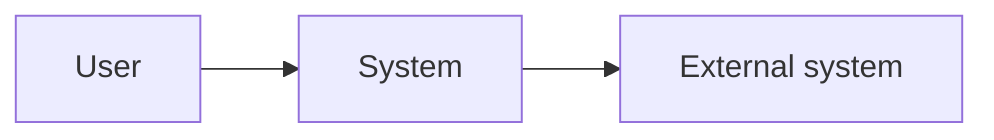
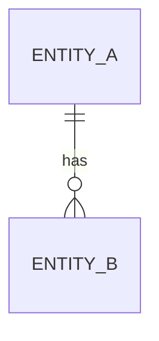
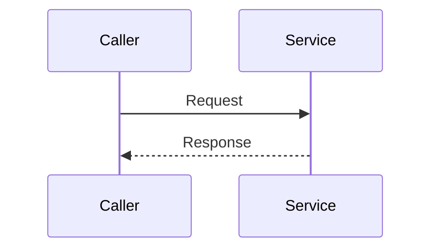

# <System> architecture

<What the system does, in one paragraph, and what this document covers. Link the
handbook for concepts and the specs for exact interfaces.>

## Contents

- [1. Context](#1-context)
- [2. Components](#2-components)
  - [2.1 <Component>](#21-component)
- [3. Data](#3-data)
- [4. Key flows](#4-key-flows)
  - [4.1 <Flow>](#41-flow)
- [5. Cross-cutting concerns](#5-cross-cutting-concerns)
- [6. Decisions](#6-decisions)
- [7. Known gaps](#7-known-gaps)

## 1. Context

<The system, its users, and the external systems it depends on.>

## 2. Components

### 2.1 <Component>

- **Location:** `<path>`.
- **Responsibility:** <what it does>.
- **Owns:** <data or decisions only it controls>.
- **Depends on:** <components, stores, or services>.
- **Called by:** <callers>.

## 3. Data

<The main entities, which component owns each, and where each is stored.>

## 4. Key flows

### 4.1 <Flow>

<One sentence on what the diagram shows.>

<How the flow handles partial failure, retries, duplicates, and races.>

## 5. Cross-cutting concerns

<How consistency, caching, concurrency, security, and observability work, and
where each is implemented.>

## 6. Decisions

| Decision | Driver | ADR |
| --- | --- | --- |
| <What was chosen> | <The requirement that forced it> | <Link> |

## 7. Known gaps

- <A verified gap between the documented and intended design, or a known
  weakness.>
