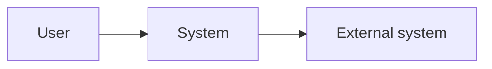
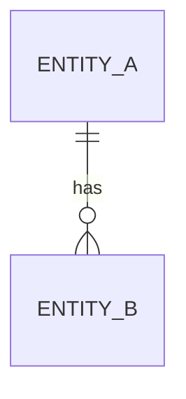
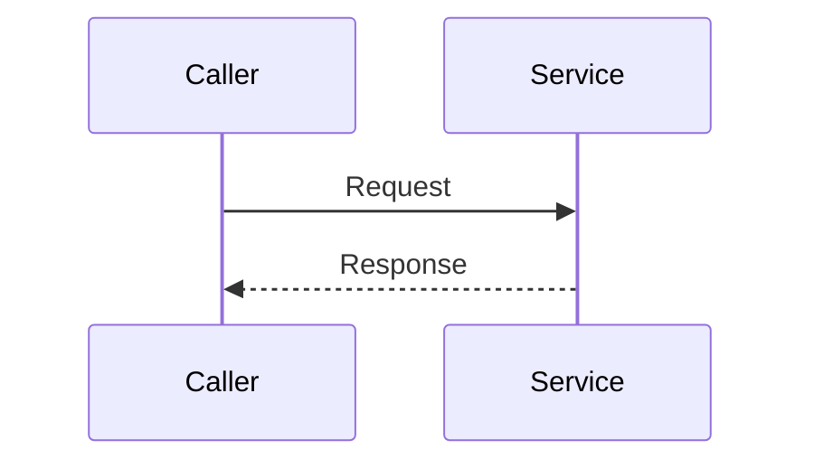

# <System> architecture

<What the system does, in one paragraph, and what this document covers. Link the
handbook for concepts and the specs for exact interfaces.>

## Context

<The system, its users, and the external systems it depends on.>

## Components

### <Component> (`<path>`)

- **Responsibility:** <what it does>.
- **Owns:** <data or decisions only it controls>.
- **Depends on:** <components, stores, or services>.
- **Called by:** <callers>.

## Data

<The main entities, which component owns each, and where each is stored.>

## Key flows

### <Flow>

<One sentence on what the diagram shows.>

<How the flow handles partial failure, retries, duplicates, and races.>

## Cross-cutting concerns

<How consistency, caching, concurrency, security, and observability work, and
where each is implemented.>

## Decisions

| Decision | Driver | ADR |
| --- | --- | --- |
| <What was chosen> | <The requirement that forced it> | <Link> |

## Known gaps

- <A verified gap between the documented and intended design, or a known
  weakness.>
