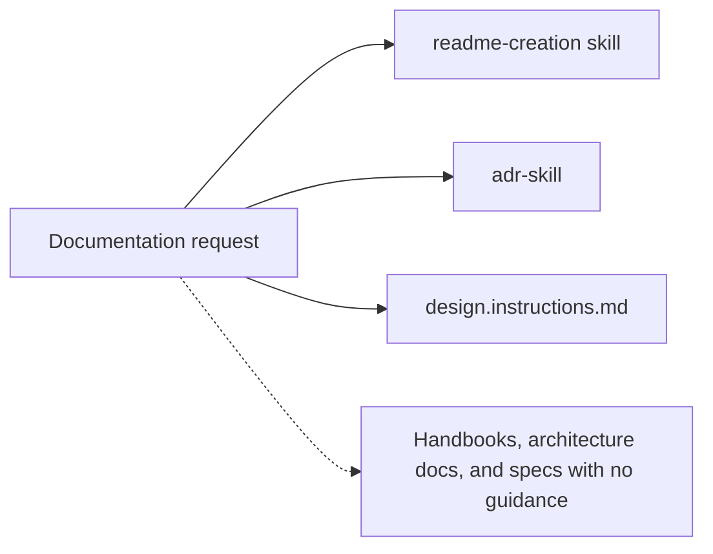
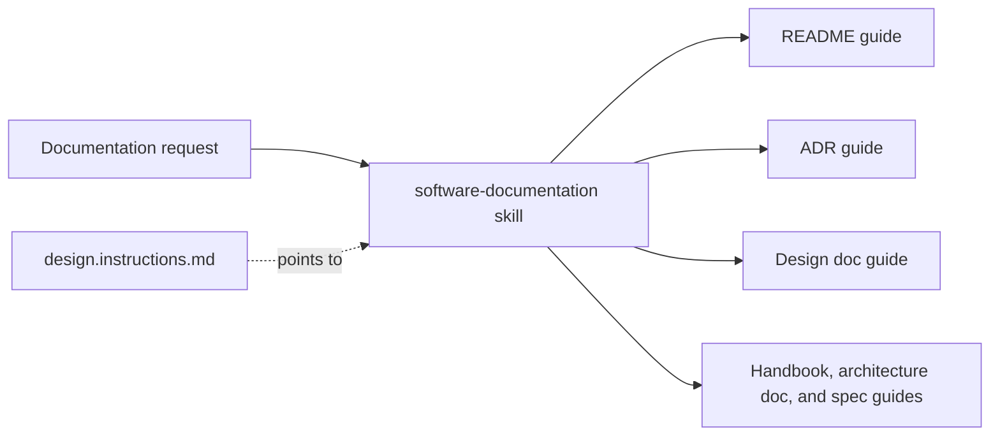

# Consolidate documentation skills under software-documentation

## Context and Problem Statement

Documentation guidance was split across the `readme-creation` skill, the
`adr-skill` skill, and the design doc layout in
`instructions/design.instructions.md`. Handbooks, architecture docs, and specs
had no guidance, and nothing helped an agent decide which kind of document a
piece of information belongs in. The most common failure was the level of
detail: jargon in onboarding material, schemas in overviews, and several levels
of depth in one paragraph.

How should the collection guide agents to pick the right document type and
write it at the right level of detail?

## Decision Drivers

* An agent must choose the document type before writing, based on the reader
  and the question the document answers.
* Every type needs a comparable profile (reader, question, language, coverage,
  depth, intent, length, and stopping rule) with good and bad examples.
* Rules shared by all types should be written once.
* README and ADR requests must keep loading the right guidance.
* Always-on instructions should stay short.
* Attribution for the third-party ADR material must be preserved.

## Considered Options

* One software-documentation skill with a guide per type
* Separate skills per document type
* Always-on documentation instructions

## Decision Outcome

Chosen option: "One software-documentation skill with a guide per type",
because routing between types and the shared rules only work when one skill
sees every type, while each type's guide loads only when it is needed.

### Before and After

Use block diagrams because the decision changes which components hold the
documentation guidance.

#### Before

#### After

### Consequences

* Good, because one routing table and one set of shared rules cover every
  document type.
* Good, because handbooks, architecture docs, specs, and design docs now have
  guides with profiles, templates, and examples.
* Good, because only the routing and shared rules load with the skill; each
  type's guide is read on demand.
* Bad, because one description must now trigger for README, ADR, and all other
  documentation requests, so under-triggering is a risk to measure with
  `evals/triggering.json`.
* Bad, because the skill names `readme-creation` and `adr-skill` no longer
  exist, so invoking them by name stops working.
* Neutral, because the Apache-2.0 and MADR material now sits inside a broader
  skill, with `SOURCE.txt` listing exactly which files it covers.

### Confirmation

The decision is confirmed when `validate_skill.py` passes, the ADR scripts work
from their new location, and the trigger evals in `evals/triggering.json` load
the skill for README, ADR, design doc, handbook, architecture doc, and spec
requests but not for the negative cases.

## Pros and Cons of the Options

### One software-documentation skill with a guide per type

* Good, because routing can compare all types side by side.
* Good, because shared rules are written once.
* Neutral, because the skill folder is larger, though only `SKILL.md` loads up
  front.
* Bad, because a single description must cover many kinds of request.

### Separate skills per document type

* Good, because each description can be narrow and precise.
* Bad, because no single skill can route between types, so content lands in
  the wrong document.
* Bad, because the shared rules would be copied into every skill and drift
  apart.

### Always-on documentation instructions

* Good, because the guidance is always present.
* Bad, because long per-type guidance would load into every session, including
  sessions with no documentation work.

## More Information

* Related: [Require before-and-after diagrams in ADRs](2026-09-14-require-before-after-diagrams.md),
  which still applies to the ADR guide.
* The type taxonomy came from a design conversation that split design docs,
  which propose a change, from architecture docs, which describe the system as
  built.
