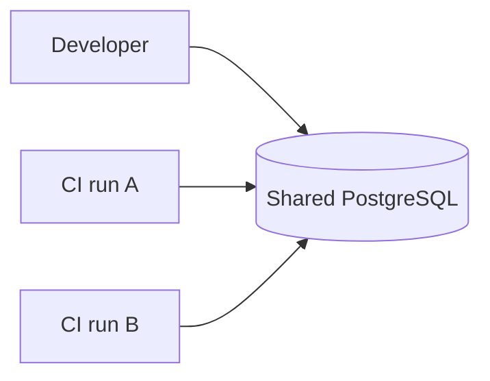
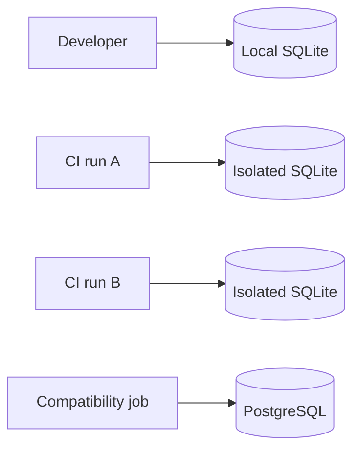

# ADR Example

Use this as the reference shape for new ADRs. It describes an imaginary project, so copy its structure, not its names, facts, or decisions. Keep real ADRs specific and free of placeholder text.

````markdown
---
status: accepted
date: 2026-06-25
decision-makers: Sarah Chen, Joel
consulted: Alex from Database Platform
informed: Frontend team, QA
---

# Use SQLite for local development database

## 1. Context and Problem Statement

Integration tests currently use a shared PostgreSQL instance. This makes tests flaky when developers or CI jobs write concurrently, and each CI run spends more than three minutes provisioning and seeding the database.

How can we provide a fast, isolated database for local development and CI without changing the production database choice?

## 2. Decision Drivers

* CI setup should be fast enough to keep the main pipeline under two minutes.
* Test runs must be isolated from other developers and CI jobs.
* Developers should be able to run integration tests offline.
* Production remains PostgreSQL, so the local test path must not hide PostgreSQL compatibility risk.

## 3. Considered Options

* SQLite via better-sqlite3
* Docker PostgreSQL per CI run
* In-memory PostgreSQL with pg-mem

## 4. Decision Outcome

Chosen option: "SQLite via better-sqlite3", because it best satisfies the speed, isolation, and offline-development drivers while keeping PostgreSQL compatibility risk explicit instead of changing the production database choice.

### 4.1 Before and After

Use block diagrams because the decision changes database topology and isolation boundaries.

#### 4.1.1 Before



#### 4.1.2 After



### 4.2 Consequences

* Good, because CI database setup drops from minutes to seconds.
* Good, because developers can run integration tests offline.
* Good, because each test run can use an isolated database file.
* Bad, because SQLite and PostgreSQL have different SQL dialects, so shared queries must avoid engine-specific syntax.
* Bad, because PostgreSQL-specific behavior still needs separate compatibility coverage.

### 4.3 Confirmation

The decision is confirmed when the main test pipeline uses SQLite by default, a PostgreSQL compatibility job exists, and integration tests pass in both modes.

## 5. Pros and Cons of the Options

### 5.1 SQLite via better-sqlite3

* Good, because it has no external service dependency and can run fully offline.
* Good, because isolated database files avoid cross-run interference.
* Neutral, because queries must stay within the shared subset of SQLite and PostgreSQL.
* Bad, because it cannot exercise PostgreSQL-specific behavior in the main test path.

### 5.2 Docker PostgreSQL per CI run

* Good, because it matches production database behavior.
* Neutral, because developers need Docker locally for the same experience.
* Bad, because container startup and seeding keep the main pipeline slow.

### 5.3 In-memory PostgreSQL with pg-mem

* Good, because it avoids external infrastructure.
* Neutral, because it emulates PostgreSQL rather than running the real engine.
* Bad, because unsupported schema features can make failures hard to interpret.

## 6. More Information

* Related ADR: [Use PostgreSQL for production](2026-05-01-use-postgresql-for-production.md)
* Follow-up: add weekly PostgreSQL compatibility CI job.
````
